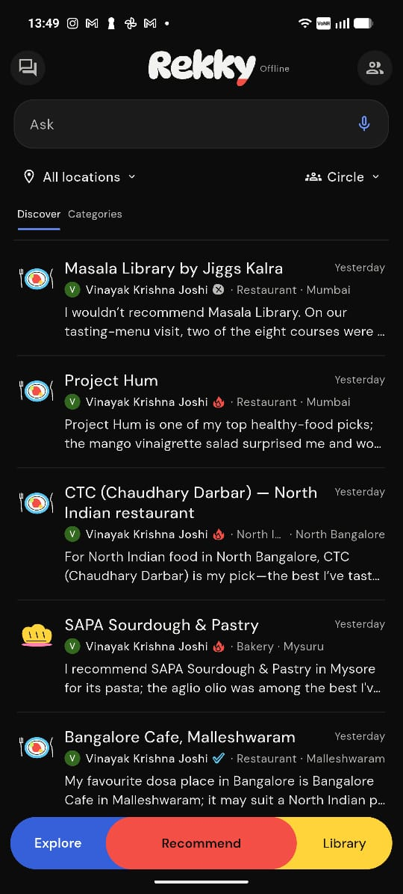
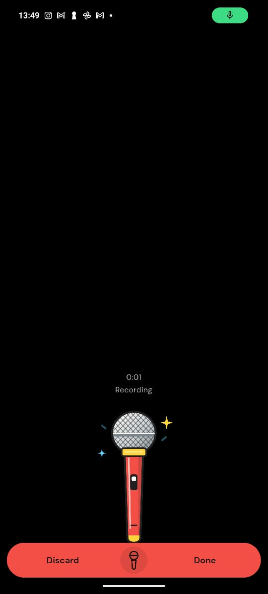
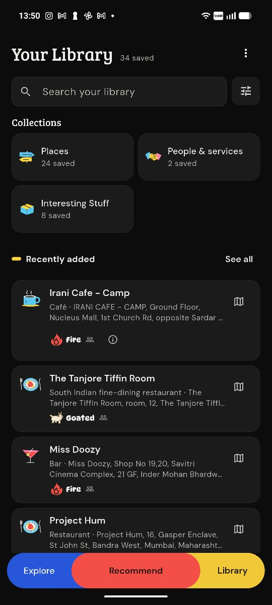

# Hey, I'm Sahil 👋

I'm a software engineer building across **AI, real-time voice, mobile, and crypto**. I've built agents with wallet-based permissions and on-chain lineage, extended speech-to-speech pipelines with speaker verification and relevance gating, and worked on mobile apps with offline persistence. I like getting into the details: how a streaming conversation handles interruptions, what belongs in client state, and where authorization should be enforced.

I'm especially drawn to the intersection of **technology, human behavior, and good product design**. A voice assistant knowing when to stay quiet matters as much as how quickly it can answer. Those are the kinds of problems I enjoy: understanding the behavior a product needs, then working through the engineering to make it happen. Right now, I'm bringing that together in **Rekky**, built with Flutter, Rust, and PostgreSQL.

### 🚀 Things I've been building

**📍 Rekky — A social network for useful knowledge**

Some of the most useful things we know come from other people. A restaurant worth visiting, a doctor we trust, a book that changed how we think, or a little-known service that makes life easier. But so much of this knowledge gets lost in conversations, buried in chats, or never shared at all.

I'm building **Rekky**, a social network that makes sharing and discovering useful recommendations and knowledge effortless.

Instead of filling out forms or writing lengthy reviews, you simply **speak, and AI does the heavy lifting** — turning your thoughts and experiences into useful, organized recommendations that others can discover.

And when you're looking for something, you can just ask. Rekky helps you find relevant recommendations and insights from people you know and trust, without digging through endless reviews or group chats.

The bigger idea? **Make the collective knowledge of the people around us genuinely accessible and useful.**

`Flutter` `Rust` `PostgreSQL` `AI`

<table>
  <tr>
    <th align="center">Explore</th>
    <th align="center">Recommend</th>
    <th align="center">Library</th>
  </tr>
  <tr>
    <td align="center" width="33%">
      
    </td>
    <td align="center" width="33%">
      
    </td>
    <td align="center" width="33%">
      
    </td>
  </tr>
</table>

**🎙️ [Speech-to-Speech](https://github.com/sahilvermadev/speech-to-speech) — Helping a voice assistant know when to respond**

My fork of Hugging Face's speech pipeline adds opt-in speaker verification, relevance gating, and candidate turns that keep ignored or cancelled speech out of committed conversation history. It also includes a browser test console and audio-runtime controls. The original pipeline and model integrations come from upstream.

`Python` `WebSockets` `Streaming Audio` `ONNX` `Pytest`

**🍳 [Foodchat](https://github.com/sahilvermadev/foodchat) — A cooking assistant across web and mobile**

A LibreChat-based project I adapted for recipes, shopping, imports and hands-free cooking, with an Expo/React Native client and offline state. The cooking code uses the earlier Rekky name; it is a separate project from the Flutter app above. LibreChat provides the underlying multi-user chat foundation.

`React Native` `TypeScript` `Node.js` `MongoDB` `SQLite`

**💬 [Revynd](https://github.com/sahilvermadev/revynd) — Exploring conversational digital twins**

A historical prototype for turning chat-history patterns into a profile and an interactive conversation. The public showcase explains the product and architecture; its implementation and source conversations remain private.

`Python` `FastAPI` `React` `PostgreSQL` `WebSockets`

**🧠 [ThoughtLine](https://github.com/sahilvermadev/thoughtline) — AI agents meet decentralized ownership**

An experiment in what happens when AI agents can be created from your own knowledge, shared with others, and given programmable permissions.

`Next.js` `TypeScript` `Solidity` `0G Storage`

### 🧩 Things that interest me

- **AI & new possibilities** — Not just making existing software faster, but building things that weren't practical before.
- **Products & people** — Why some ideas catch on, why others don't, and what makes software genuinely enjoyable to use.
- **Systems & engineering** — Understanding how things work under the hood and figuring out how to make them better.
- **Building for fun** — Hackathons, side projects, strange ideas, and the occasional rabbit hole.

### 🌱 Beyond the screen

You'll probably find me on a golf course, out for a run, playing badminton, or going down a completely unrelated Wikipedia rabbit hole.

I enjoy meeting people who are curious about the world, like making things, and aren't afraid to experiment.

**Currently:** Building Rekky, exploring new ideas, and open to interesting software engineering opportunities.

[**LinkedIn ↗**](https://www.linkedin.com/in/sahil-verma-2k)
