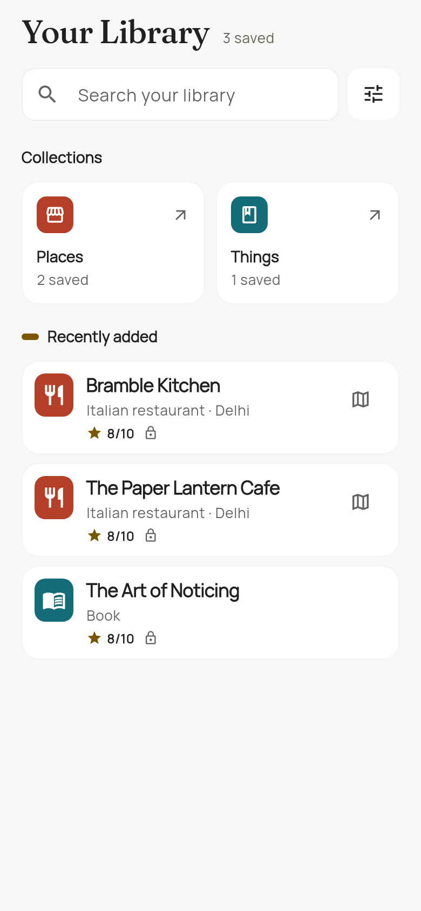
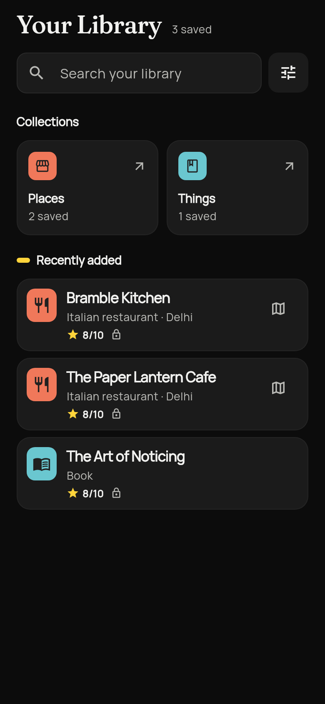

# Sahil Verma

Software engineer building mobile products, APIs and financial systems. Previously at **Vayana**, where I worked for over two years across backend services and smart contracts. I am now building **Rekky**, a Flutter app backed by Rust and PostgreSQL.

At Vayana, I owned the backend API layer for a development-stage financial-document vault using NestJS, PostgreSQL and Amazon S3. I also developed upgradeable Solidity contracts for investment and supply-chain financing workflows, including escrow, multisignature approvals and fuzz testing.

## Selected work

### Rekky — Flutter mobile app

Speak a recommendation once, then recover it through a natural-language question or an organized Library.

- **Flutter / Dart · Rust / Axum · PostgreSQL / SQLx · SQLite**
- Sign-in, voice capture, persistent recording drafts, asynchronous processing, cited answers, owner editing and shared API fixtures.
- Product preview below; this portfolio does not offer source-code access.

Synthetic Library previews from a development snapshot, using fictional sample entries:

  
  

### [BAXUS Deals — browser extension](https://github.com/sahilvermadev/baxus-deal)

A hackathon prototype that matches retailer bottle listings against a marketplace catalog and shows price differences.

- **JavaScript · Chrome Manifest V3 · Python / FastAPI · Crawl4AI**
- Browser integration, catalog caching, fuzzy matching and a server-side extraction fallback.
- Includes a recorded demo, local setup and the prototype's known limitations.

### [ThoughtLine — full-stack hackathon prototype](https://github.com/sahilvermadev/thoughtline)

Create an AI agent from source material, publish its capabilities, encrypt its private data and control usage through on-chain authorization.

- **Next.js / TypeScript · Solidity / Hardhat · Vitest · 0G Storage**
- Streaming workflows, provider/storage interfaces, separate usage and breeding permissions, and contract tests.
- The verifier is a demo stub; the repository explains the remaining trusted-execution and key-custody limitations.

## Working style

Written product decisions, explicit API boundaries, regression tests and honest distinctions between prototypes, verified behavior and production operation. I use AI coding tools and take responsibility for understanding and reviewing the resulting changes.

I am open to software engineering opportunities in **Bengaluru**, including Flutter and product engineering roles, with openness to strong opportunities in Delhi.

[LinkedIn](https://www.linkedin.com/in/sahil-verma-2k)
